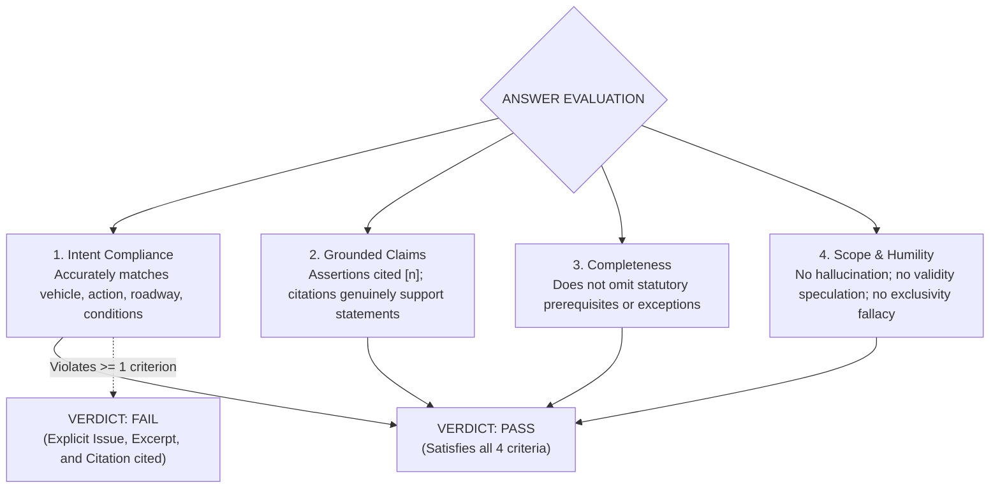
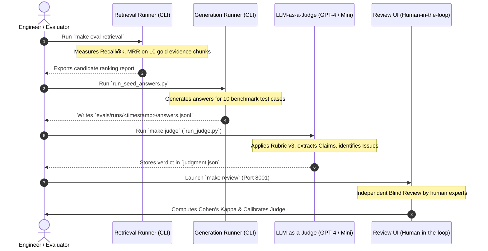

# Evaluation Test Cases & Quality Assurance Specification
## Project: traffic-chatbot-vn — Evaluating Vietnamese Traffic Law Retrieval Quality

This document outlines the evaluation philosophy, benchmark test suites, ground-truth datasets, grading standards, and automated judge workflows integrated with human-in-the-loop calibration for **traffic-chatbot-vn**.

---

### TABLE OF CONTENTS
1. [Evaluation Philosophy & Methodology](#1-evaluation-philosophy--methodology)
2. [Core Benchmark Suite (`corpus-seed-10`)](#2-core-benchmark-suite-corpus-seed-10)
3. [Task Typology](#3-task-typology)
4. [Error Taxonomy](#4-error-taxonomy)
5. [Execution Workflow](#5-execution-workflow)
6. [Playbook for Adding New Test Cases](#6-playbook-for-adding-new-test-cases)

---

### 1. Evaluation Philosophy & Methodology

#### 1.1. Why Traditional Metrics (BLEU / ROUGE) Fail in Legal Domains
- In classical NLP, **BLEU** and **ROUGE** measure n-gram lexical overlap between model answers and reference texts.
- **The Fatal Flaw:**
  - An answer changing *"50 km/h"* to *"60 km/h"* differs by only one token (ROUGE still exceeds 95%), yet from a legal standpoint it is **completely wrong**, potentially leading a driver to incur fines or commit safety violations.
  - Conversely, an answer expressed in distinct wording that preserves 100% legal accuracy receives poor BLEU scores.
- **Project Solution:** Adopt a **Binary Pass/Fail label based on a rigorous semantic rubric**, coupled with automated **Claim-Level LLM-as-a-Judge** scoring and **Independent Blind Human Calibration**.

#### 1.2. Four Pillars of the Evaluation Rubric (Rubric v3)
An answer achieves a **Pass** verdict if and only if it satisfies all 4 criteria concurrently:



---

### 2. Core Benchmark Suite (`corpus-seed-10`)

The dataset [corpus-seed-10.jsonl](file:///Users/hieuquockieu/Desktop/workspace/traffic-chatbot-vn/evals/corpus-seed-10.jsonl) represents focused yet representative retrieval challenges across traffic statutory corpora.

---

#### Case 001: Statutory Definition & Legal Concepts
- **Case ID:** `corpus_seed_001`
- **Topic:** Distinguishing dual carriageways from two-way roads divided only by painted markings.
- **Authority:** Circular 31/2019/TT-BGTVT, Article 3, Clause 6; file `TT.31.2019.TT.BGTVT.docx` (Chunk `00d10ef85c589909593d64cf`).
- **Benchmark Question:**
  > *"According to Circular 31/2019/TT-BGTVT in the corpus, is a two-way road divided only by painted lane markings considered a dual carriageway (đường đôi)?"*
- **Expected Answer:** **No**. A dual carriageway must have traffic directions separated by a **median strip**; roads separated solely by painted markings are explicitly not dual carriageways.
- **Mandatory Points (`must_include`):**
  1. Affirm that roads divided only by paint markings are not dual carriageways.
  2. State the mandatory requirement: a physical median strip.
- **Claims to Avoid (`avoid_claims`):**
  - Equating painted markings with median strips.
  - Extrapolating missing retrieved context into claims about the entire legal corpus.
- **Technical Challenge:** Evaluates comprehension of legal definitions and parenthetical exclusions: `(trường hợp phân biệt bằng vạch sơn thì không phải đường đôi)`.

---

#### Case 002: Complex Table Matrix Lookup
- **Case ID:** `corpus_seed_002`
- **Topic:** Passenger car speed limits within densely populated areas.
- **Authority:** Circular 31/2019/TT-BGTVT, Article 6; file `TT.31.2019.TT.BGTVT.docx` (Chunk `ef44bfa6d2c11cba430ba2d4`).
- **Benchmark Question:**
  > *"According to the table in Article 6 of Circular 31/2019/TT-BGTVT in the corpus, what is the maximum speed for a passenger car on a two-way road inside a densely populated area, without expressways or separate speed limit signs?"*
- **Expected Answer:** The maximum speed per the statutory table is **50 km/h** under the specified conditions.
- **Mandatory Points (`must_include`):**
  1. Exact speed: **50 km/h**.
  2. Applied strictly to two-way roads within populated areas.
- **Claims to Avoid (`avoid_claims`):**
  - Selecting **60 km/h** from the dual carriageway / one-way 2-lane column.
  - Applying expressway speed rules.
- **Technical Challenge:** Multi-dimensional table parsing (vehicle row intersected with roadway column) avoiding column drift in markdown formats.

---

#### Case 003: Vehicle Category Distinction
- **Case ID:** `corpus_seed_003`
- **Topic:** Motorcycle speed limit outside populated areas on dual carriageways.
- **Authority:** Circular 31/2019/TT-BGTVT, Article 7; file `TT.31.2019.TT.BGTVT.docx` (Chunk `4749485a68eb10b081da85ef`).
- **Benchmark Question:**
  > *"According to the table in Article 7 of Circular 31/2019/TT-BGTVT in the corpus, what is the maximum speed for a motorcycle (xe mô tô) traveling outside densely populated areas on a dual carriageway (not an expressway, no separate speed sign)?"*
- **Expected Answer:** The statutory maximum speed is **70 km/h** for motorcycles.
- **Mandatory Points (`must_include`):**
  1. Exact speed: **70 km/h**.
  2. Matched to row "xe mô tô" and column "đường đôi".
- **Claims to Avoid (`avoid_claims`):**
  - Confusing "xe mô tô" (motorcycle) with "xe gắn máy" (moped) to answer 40 km/h.
  - Picking 90 km/h (cars) or 80 km/h (>30 passenger buses).
- **Technical Challenge:** The table in Article 7 contains 4 distinct vehicle rows. The model must isolate row 3 (*"buses, tractor-trailers... motorcycles; specialized cars..."*) rather than defaulting to row 1.

---

#### Case 004: Statutory Exceptions & Upper Ceiling
- **Case ID:** `corpus_seed_004`
- **Topic:** Maximum permissible speed of mopeds (xe gắn máy) and electric scooters on roadways.
- **Authority:** Circular 31/2019/TT-BGTVT, Article 8; file `TT.31.2019.TT.BGTVT.docx` (Chunk `d6268f059648c95245c4b14f`).
- **Benchmark Question:**
  > *"According to Article 8 of Circular 31/2019/TT-BGTVT in the corpus, what is the maximum speed for mopeds (including electric mopeds) on non-expressway roadways?"*
- **Expected Answer:** For mopeds (including electric mopeds), maximum speed is **not to exceed 40 km/h** (excluding expressways).
- **Mandatory Points (`must_include`):**
  1. Ceiling limit: Not exceeding **40 km/h**.
  2. Correct category: Special-use motorcycles, mopeds (including electric mopeds).
- **Claims to Avoid (`avoid_claims`):**
  - Generalizing the 40 km/h ceiling to standard motorcycles.
  - Suggesting mopeds are permitted on expressways.
- **Technical Challenge:** Detecting overriding statutory exceptions (Article 8 acts as a specific statutory carve-out over Articles 6 and 7).

---

#### Case 005: Numeric Boundary Conditions
- **Case ID:** `corpus_seed_005`
- **Topic:** Minimum safe following distances at speed thresholds (60 km/h and 80 km/h).
- **Authority:** Circular 31/2019/TT-BGTVT, Article 11, Clause 2, Point a; file `TT.31.2019.TT.BGTVT.docx` (Chunk `d9a189322b5af7963da4b1d0`).
- **Benchmark Question:**
  > *"According to Article 11 of Circular 31/2019/TT-BGTVT in the corpus, on dry surfaces without specific minimum distance signage, what are the minimum safe distances required when driving at exactly 60 km/h and exactly 80 km/h?"*
- **Expected Answer:** On dry surfaces: driving at exactly 60 km/h requires **35 m**; driving at exactly 80 km/h (falling in range \(60 < V \le 80\)) requires **55 m**.
- **Mandatory Points (`must_include`):**
  1. At 60 km/h: **35 m**.
  2. At 80 km/h: **55 m**.
  3. Condition: Dry road surface.
- **Claims to Avoid (`avoid_claims`):**
  - Placing 80 km/h in range \(80 < V \le 100\) and answering 70 m (violating mathematical \(\le\) boundary).
  - Generalizing dry road rules to all weather conditions.
- **Technical Challenge:** Parsing numeric interval boundaries: distinguishing equality (\(V = 60\)) from upper-closed ranges (\(60 < V \le 80\)).

---

#### Case 006: Qualitative Weather Reasoning
- **Case ID:** `corpus_seed_006`
- **Topic:** Safe distance adjustment in rain and slippery surface conditions.
- **Authority:** Circular 31/2019/TT-BGTVT, Article 11, Clause 2, Point b; file `TT.31.2019.TT.BGTVT.docx` (Chunk `d9a189322b5af7963da4b1d0`).
- **Benchmark Question:**
  > *"According to Article 11 of Circular 31/2019/TT-BGTVT in the corpus, during rain or on slippery roads, can drivers maintain the same minimum distance prescribed for dry road surfaces?"*
- **Expected Answer:** **No**. Drivers must adjust following distance to be **greater than** the value on signs or dry surface tables; the law does not set a fixed meter addition or multiplier.
- **Mandatory Points (`must_include`):**
  1. Must maintain a distance greater than dry road benchmarks.
  2. Does not invent non-existent multipliers or fixed distance metrics.
- **Claims to Avoid (`avoid_claims`):**
  - Claiming the dry table distance remains sufficient.
  - Fabricating rules such as *"must double (2x)"* or *"must add 20m"*.
- **Technical Challenge:** Faithfulness test: stopping at qualitative legal principles without fabricating mathematical formulas unmentioned in the text.

---

#### Case 007: Dual Dependent Duration Constraints
- **Case ID:** `corpus_seed_007`
- **Topic:** Validity period of International Driving Permits (IDP).
- **Authority:** Circular 29/2015/TT-BGTVT, Article 5, Clause 1; file `29.2015.TT.BGTVT.docx` (Chunk `23ccd2cc53b64be089cf8a05`).
- **Benchmark Question:**
  > *"According to Article 5 of Circular 29/2015/TT-BGTVT in the corpus, are International Driving Permits (IDP) always issued with a full 3-year validity?"*
- **Expected Answer:** **No**. An IDP is valid for **not more than 3 years** from issuance and **must match the remaining validity period of the national driving license**.
- **Mandatory Points (`must_include`):**
  1. Maximum ceiling: "not more than 3 years".
  2. Dependent constraint: constrained by remaining validity of national license.
- **Claims to Avoid (`avoid_claims`):**
  - Stating all IDPs carry unconditional 3-year validity.
  - Omitting dependence on the national driving license.
- **Technical Challenge:** Capturing dual constraints where one acts as an upper ceiling and the other as a dependent ceiling.

---

#### Case 008: Multi-Criteria Eligibility
- **Case ID:** `corpus_seed_008`
- **Topic:** IDP applicant eligibility and national license prerequisites.
- **Authority:** Circular 29/2015/TT-BGTVT, Article 6; file `29.2015.TT.BGTVT.docx` (Chunk `f0477521c68def1a31f8fdd6`).
- **Benchmark Question:**
  > *"According to Article 6 of Circular 29/2015/TT-BGTVT in the corpus, who is eligible for an IDP and what conditions must their national driving license meet?"*
- **Expected Answer:** Vietnamese citizens or foreign nationals **holding a permanent residence card in Vietnam**, possessing an unexpired national driving license **issued by Vietnam using PET material**.
- **Mandatory Points (`must_include`):**
  1. Vietnamese or foreign nationals holding a permanent residence card in Vietnam.
  2. National license issued by Vietnam.
  3. National license fabricated from PET material and unexpired.
- **Claims to Avoid (`avoid_claims`):**
  - Extending eligibility to temporary tourists without permanent residency.
  - Accepting foreign-issued licenses for IDP conversion under this Article.
- **Technical Challenge:** Capturing a conjunctive set of 3 mandatory requirements; detecting if the model drops "PET material" or "permanent residency".

---

#### Case 009: Necessary vs. Sufficient Conditions
- **Case ID:** `corpus_seed_009`
- **Topic:** Mandatory travel documentation when operating vehicles abroad under the Vienna Convention with a Vietnamese IDP.
- **Authority:** Circular 29/2015/TT-BGTVT, Article 10, Clause 1; file `29.2015.TT.BGTVT.docx` (Chunk `e4cc5177cef207e66f4170fe`).
- **Benchmark Question:**
  > *"According to Article 10 of Circular 29/2015/TT-BGTVT in the corpus, is carrying only the Vietnamese-issued IDP sufficient when driving in a Vienna Convention signatory nation?"*
- **Expected Answer:** **Not sufficient**. Drivers must carry **both the IDP and the national driving license**, and comply with local traffic laws of the host nation.
- **Mandatory Points (`must_include`):**
  1. Must carry both documents: IDP and national driving license.
  2. Must obey local traffic laws.
- **Claims to Avoid (`avoid_claims`):**
  - Stating the IDP completely substitutes the domestic driver license.
  - Extrapolating this provision universally to non-Vienna Convention nations.
- **Technical Challenge:** Reasoning error detection: carrying an IDP is a necessary but insufficient condition.

---

#### Case 010: Cross-Article Synthesis (Multi-Hop)
- **Case ID:** `corpus_seed_010`
- **Topic:** Comparing domestic validity in Vietnam between Vietnamese-issued IDPs and foreign-issued IDPs.
- **Authority:** Circular 29/2015/TT-BGTVT, combining **Article 10, Clause 2** (Chunk `e4cc5177cef207e66f4170fe`) and **Article 11, Clause 1** (Chunk `2c6f7b9a1210ffd8b30dfb75`).
- **Benchmark Question:**
  > *"According to Articles 10 and 11 of Circular 29/2015/TT-BGTVT in the corpus, how does the validity within Vietnam differ between a Vietnamese-issued IDP and an IDP issued by another Vienna Convention signatory nation?"*
- **Expected Answer:**
  - Vietnamese-issued IDP: **Not valid for use within Vietnamese territory**.
  - Foreign-issued IDP (from Vienna Convention members): **Valid within Vietnam**, provided drivers carry both the IDP and their corresponding national license, and obey Vietnamese traffic laws.
- **Mandatory Points (`must_include`):**
  1. Clearly state Vietnamese-issued IDP is invalid within Vietnam.
  2. Clearly state foreign Vienna Convention IDP is valid when accompanied by corresponding national license.
  3. Compliance with Vietnamese traffic laws.
- **Claims to Avoid (`avoid_claims`):**
  - Declaring all IDPs invalid domestically.
  - Suggesting foreign IDPs require no accompanying national license.
- **Technical Challenge:** Multi-hop RAG synthesis: Retriever must fetch candidate chunks across two disparate articles, and LLM must contrast two opposing legal regimes without confusion.

---

### 3. Task Typology

| Case ID | RAG Capability Under Test | Data Complexity | Primary Engineering Challenge |
| :--- | :--- | :--- | :--- |
| **001** | `definition` | Legal definition parsing | Must not drop parenthetical negative exclusion. |
| **002** | `table_lookup` | 2D matrix (Vehicle row $\times$ Road column) | Accurate row/column intersection without adjacent column drift. |
| **003** | `vehicle_distinction` | Multi-level vehicle classifications | Distinguishes motorcycles vs. mopeds vs. cars. |
| **004** | `exception` | Statutory carve-outs & ceilings | Detects specific overrides over general tables. |
| **005** | `numeric_boundary` | Math boundary operators | Accurate interval reasoning: equality ($V=60$) vs. closed range ($60 < V \le 80$). |
| **006** | `conditional_reasoning` | Qualitative condition adjustment | States "greater than" without inventing mathematical formulas. |
| **007** | `duration_constraint` | Dependent duration caps | Identifies "not exceeding" ceiling and base document dependency. |
| **008** | `eligibility` | Conjunctive criteria check | Retains all criteria: permanent residency and PET material. |
| **009** | `required_documents` | Necessary vs. sufficient conditions | Identifies IDP as necessary but non-exhaustive. |
| **010** | `multi_evidence_comparison` | Multi-hop cross-article synthesis | Retrieves disparate Articles and contrasts opposing legal regimes. |

---

### 4. Error Taxonomy

The evaluation pipeline and reviewer interface classify defects into 5 standard categories:

```text
                           ┌── unsupported (Assertion not grounded in retrieved context)
                           ├── citation (Invalid citation rank or non-supporting reference)
Defect Category (Issue)    ┼── missing_condition (Omission of condition altering legal conclusion)
                           ├── wrong_answer (Factually incorrect statement vs. source)
                           └── scope (Exclusivity fallacy / unwarranted negative inference)
```

1. **`unsupported` (Lack of Grounding):**
   - The model makes an assertion not present in any retrieved chunk.
2. **`citation` (Citation Defect):**
   - Cites `[2]`, but chunk `[2]` addresses an unrelated topic; or hallucinates non-existent ranks (e.g. `[9]`).
3. **`missing_condition` (Missing Critical Caveat):**
   - States speed limit is 70 km/h while omitting *"outside populated areas on dual carriageways"*.
4. **`wrong_answer` (Factual Error):**
   - Reverses or misstates data (e.g., stating 60 km/h instead of 50 km/h).
5. **`scope` (Exclusivity Fallacy / Scope Boundary Violation):**
   - **Classic example:** Text reads: *"Applicable to Vienna Convention nations"*. Model asserts: *"Non-member nations strictly reject IDPs"*. Unwarranted negative extrapolation.

---

### 5. Execution Workflow

The evaluation process is structured into 4 independent, reproducible phases:



#### Key CLI Commands:
- **Fast offline test execution:**
  ```bash
  make test
  make check
  ```
- **Evaluate Retrieval layer (zero LLM cost):**
  ```bash
  make eval-retrieval
  ```
- **Run automated evaluation via LLM-as-a-Judge:**
  ```bash
  make judge
  ```
- **Launch Human Reviewer interface:**
  ```bash
  make review
  ```

---

### 6. Playbook for Adding New Test Cases

When expanding the corpus with new statutes (e.g., Decree 100/2019/ND-CP, Decree 123/2021/ND-CP), follow this 5-step playbook:

1. **Step 1: Formulate Discriminative Queries:**
   - Target queries with tricky boundary conditions, tables, or common public misconceptions.
2. **Step 2: Identify Gold Evidence (`gold_evidence`):**
   - Pinpoint `chunk_id`, document number, and verbatim text in `data/index/chunks.jsonl`.
3. **Step 3: Define Expected Answer & Rubrics:**
   - Define `must_include`: Mandatory semantic concepts required in answers.
   - Define `avoid_claims`: Hallucination traps and common misreadings.
4. **Step 4: Append to Benchmark Dataset:**
   - Insert new records into `evals/corpus-seed-10.jsonl` (or an extended benchmark dataset).
5. **Step 5: Freeze Manifest:**
   - Record SHA-256 hashes of the dataset in evaluation manifests to ensure reproducible evaluation across future iterations.
