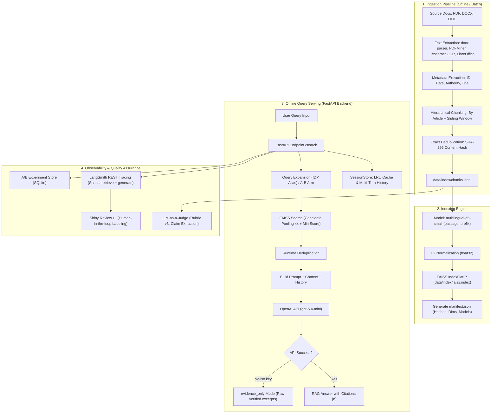

# System Requirements & Software Design Document (SRD)
## Project: traffic-chatbot-vn — Technical Architecture & Reproduction Blueprint

---

### 1. System Architecture Overview

The **traffic-chatbot-vn** system is engineered following a **Modular & Production-Ready RAG** design, prioritizing accuracy, auditability, data-drift prevention, and minimal dependency on bloated frameworks.



---

### 2. Detailed Module Design

#### 2.1. Ingestion Module (`../rag_traffic/ingest.py`)

##### A. Multi-Format Document Processing
- **`.docx` Format:**
  - *The Problem:* Reading `paragraphs` and `tables` separately (a common naive approach) separates speed/weight tables from their parent statutory Article headings, destroying local context.
  - *Solution:* Utilize `document.iter_inner_content()` in `python-docx` to traverse paragraphs and tables in sequential document order:
    ```python
    for block in document.iter_inner_content():
        if isinstance(block, Table):
            for row in block.rows:
                blocks.append(" | ".join(cell.text for cell in row.cells))
        else:
            blocks.append(block.text)
    ```
- **`.pdf` Format:**
  - First attempts extraction via `pdfminer.high_level.extract_text` for native digital text (fast and accurate).
  - *OCR Fallback:* If extracted text length `< 200` characters (indicating a scanned PDF or photo), the system automatically activates `pdf2image.convert_from_path` at 250 DPI and runs `pytesseract.image_to_string(lang='vie')`. Configurable via `RAG_TESSERACT_ROOT` or `RAG_TESSERACT_CMD` for unprivileged environments.
- **Legacy `.doc` Format:**
  - Invokes headless LibreOffice (`soffice --headless --convert-to txt:Text`) or macOS `textutil` to convert legacy files into plain text within temporary workspaces.
- **File Priority:**
  - When scanning sources, priority order is `.docx` > `.doc` > `.pdf`, as `.docx` consistently offers the cleanest typography and fewest OCR artifacts.

##### B. Filtering & Intelligent Metadata Extraction
- **Excluding Draft Documents:** Files containing `du thao` (normalized via NFKD) are filtered from the primary index and logged under `exclusions` in `ingestion-report.json`.
- **Statutory Document ID Regex:** Detects standard legal identifiers (e.g., `Số: 31/2019/TT-BGTVT`):
  ```python
  EXPLICIT_DOCUMENT_ID_RE = re.compile(
      r"(?im)^\s*Số\s*:\s*(\d{1,3})\s*/\s*(\d{4})\s*/\s*(TTLT|TT|NĐ|ND|QĐ|QD)\s*[-–]\s*([A-ZĐ]+(?:[-–][A-ZĐ]+)*)"
  )
  ```
- **Administrative Metadata:** Extracts titles (via keywords `THÔNG TƯ`, `NGHỊ ĐỊNH`, `QUYẾT ĐỊNH`), issuing bodies (e.g., `BỘ`, `CHÍNH PHỦ`), and issuance dates.

##### C. Hierarchical Legal Chunking
Legal texts cannot be split naively by fixed token counts, which breaks statutory provisions. The pipeline applies a two-tier strategy:
1. **Tier 1 (Article Level):** Uses regex `ARTICLE_RE = re.compile(r"(?im)^\s*(Điều\s+\d+[a-zđ]?(?:\s*[.:–-]|\s+).*)$")` to isolate complete Articles along with preamble sections.
2. **Tier 2 (Sliding Window with Overlap):** If an Article exceeds `max_chars = 1800` (e.g., extensive vehicle matrices), it is split with `overlap_chars = 180`, prioritizing line breaks (`\n`) or sentence stops (`. `).

##### D. Exact Deduplication
- Normalizes text to Unicode NFC and collapses whitespace (`re.sub(r'\s+', ' ', text).casefold()`).
- Computes SHA-256 hash: `normalized_content_hash = hashlib.sha256(canonical.encode()).hexdigest()`.
- Tracks `seen_content: set[str]` to eliminate duplicate passages across multiple source files.
- Generates unique deterministic IDs: `chunk_id = sha256(f"{source}\0{article}\0{part}\0{hash}".encode())[:24]`.
- Implements atomic writes (`.tmp` renamed to target).

---

#### 2.2. Indexing Module & Vector Database (`../rag_traffic/indexing.py`)

##### A. Embedding Model: `intfloat/multilingual-e5-small`
- Compact bi-encoder model (~118M parameters, vector dimension = 384), operating swiftly on CPU while delivering strong retrieval performance on Vietnamese text.
- **E5 Formatting Requirement:** Must prepend `passage: ` to chunk text during encoding and `query: ` to search queries. The pipeline enforces this formatting programmatically.

##### B. L2 Normalization & FAISS `IndexFlatIP`
- Cosine similarity between two vectors \(\mathbf{u}\) and \(\mathbf{v}\):
  $$\text{Cosine}(\mathbf{u}, \mathbf{v}) = \frac{\mathbf{u} \cdot \mathbf{v}}{\|\mathbf{u}\|_2 \|\mathbf{v}\|_2}$$
- Computing cosine directly in FAISS requires constant runtime normalization. Optimal solution: **Normalize vectors to unit length at embedding generation** (`normalize_embeddings=True` in `sentence-transformers`).
- When \(\|\mathbf{u}\|_2 = 1\) and \(\|\mathbf{v}\|_2 = 1\):
  $$\text{Cosine}(\mathbf{u}, \mathbf{v}) = \mathbf{u} \cdot \mathbf{v} = \text{Inner Product}$$
- Enables `faiss.IndexFlatIP(dimension)` (Exact Inner Product Search): 100% exact exhaustive search with near-instant query speeds across tens of thousands of vectors.

##### C. Data Drift Guardrails via `manifest.json`
To guard against silent data desynchronization, each index build produces `manifest.json`:
```json
{
  "schema_version": 1,
  "created_at": "2026-10-06T...",
  "embedding_model": "intfloat/multilingual-e5-small",
  "embedding_dimension": 384,
  "normalized": true,
  "document_prefix": "passage: ",
  "query_prefix": "query: ",
  "chunk_count": 1420,
  "chunks_sha256": "4b92...",
  "index_type": "IndexFlatIP"
}
```
At startup, if `chunks_sha256`, chunk count, or vector dimensions mismatch `faiss.index`, the system refuses to load and raises an explicit error.

---

#### 2.3. Retrieval Module & Semantic Search (`../rag_traffic/retriever.py`)

##### A. Query Normalization & Expansion
Users frequently employ colloquial terms rather than formal statutory phrasing. The `retrieval_query` function standardizes terms:
```python
def retrieval_query(query: str) -> str:
    return re.sub(
        r"\b(?:bằng lái(?: xe)?|giấy phép lái xe|gplx)\s+quốc tế\b(?:\s+IDP\b)?",
        "giấy phép lái xe quốc tế IDP", query, flags=re.IGNORECASE,
    )
```

##### B. Candidate Over-Fetching & Dynamic Deduplication
Because the corpus may hold both PDF scans and Word files of the same Circular, fetching exactly `k = 6` results could return 6 duplicates of a single article.
- **Over-Fetching:** Retrieves 4x candidate pool (`limit = min(k * 4, len(chunks))`).
- **Dynamic Deduplication:** If candidate text from the same `document_id` has already been observed, it is skipped.
- **Relevance Threshold (`min_score = 0.55`):** Filters low-similarity passages, preventing noise from polluting LLM context.

---

#### 2.4. Generation, Citations & Safe Fallback (`../rag_traffic/generation.py`, `citations.py`)

##### A. Strict System Prompt Constraints
```text
You are an assistant for Vietnamese traffic law inquiries.
Rely strictly on provided context snippets. Every legal assertion must have citations such as [1], [2].
Do not speculate on legal validity. If information is insufficient or possibly outdated, explicitly state so.
Distinguish vehicle types, actions, road types, and applicable conditions when mentioned in documents.
This is reference information and does not replace professional legal advice.
```

##### B. Citation Metadata Extraction (`citations.py`)
Analyzes model responses to verify citation markers `[n]` against actual retrieved context:
- `retrieved_chunk_ids`: All retrieved candidate IDs.
- `cited_source_ranks`: Referenced ranks (e.g., `[1]`, `[2]`).
- `cited_chunk_ids`: Chunks explicitly cited in generated text.
- `invalid_citation_ranks`: Out-of-bounds citation numbers (hallucinated citations).

##### C. Graceful Fallback Mode (`evidence_only`)
If `OPENAI_API_KEY` is missing, or OpenAI API calls encounter errors (timeouts, rate limits, network failures), the system degrades gracefully rather than returning 500 errors:
- Retrieves top 3 highest-scoring passages.
- Returns raw Article text with notice: *"Generation model not configured or unavailable; please cross-reference full text and document validity directly."*

---

#### 2.5. Backend API & Session Management (`app.py`, `../rag_traffic/config.py`)

##### A. Application Lifespan Management
FastAPI `asynccontextmanager` initializes `VectorRetriever` via `run_in_threadpool`, ensuring model loading does not block the async event loop. `GET /health` reports detailed readiness status.

##### B. Thread-Safe Session Store (`SessionStore`)
- Avoids global shared state to prevent cross-session leakage.
- Combines `OrderedDict` with `threading.Lock` to implement an **LRU Cache**, evicting oldest sessions beyond `max_sessions = 500`.
- Limits stored history to `max_turns = 6` and injects only the 3 most recent turns into LLM prompts to control token budget.

---

#### 2.6. Observability, A/B Testing & Evaluation (`../rag_traffic/tracing.py`, `ab.py`)

##### A. Lightweight LangSmith Tracing
- Inherits directly from `langsmith.Client` via REST API without requiring heavy LangChain orchestrators.
- Hierarchical Span structure:
  - Root Span: `rag-traffic-chat` (query, history, session metadata, code hash).
  - Child Span 1: `retrieve-sources` (retrieved document candidates).
  - Child Span 2: `generate-answer` (prompt, model, answer, RAG vs. evidence_only mode).
- Safe failure handling: Tracing network failures log warnings without disrupting user responses.

##### B. Deterministic A/B Testing Framework
- Deterministic variant assignment based on session hash:
  ```python
  def variant(session_id: str) -> str:
      return 'A' if hashlib.sha256((EXPERIMENT + session_id).encode()).digest()[0] < 128 else 'B'
  ```
  - Variant A: Base query.
  - Variant B: Query expansion with alias terms.
- Logs events and feedback to local SQLite (`events.sqlite3`).

##### C. Automated Evaluation: LLM-as-a-Judge
- Structured judgment schemas with Pydantic `Judgment` and `Issue`.
- Deconstructs answers into claim-level assertions and cross-references each claim against retrieved evidence.
- Categorizes defects: `unsupported`, `citation`, `missing_condition`, `wrong_answer`, `scope`.

##### D. Human Reviewer UI (`../review/app.py`)
- Built with Shiny for Python; connects to LangSmith API or local batch datasets.
- Enables reviewers to inspect conversations, click citations to highlight source excerpts, record Pass/Fail decisions, and input human gold corrections.

---

### 3. Engineering Highlights & Design Decisions

| Problem | Naive RAG Approach | traffic-chatbot-vn Solution | Technical Benefit |
| :--- | :--- | :--- | :--- |
| **DOCX Statutory Tables** | Reads paragraphs and tables separately. | Uses `doc.iter_inner_content()` sequentially. | Tables remain attached directly under parent Article headings. |
| **Scanned PDF Documents** | Fails or skips unreadable text. | Detects text < 200 chars and triggers Vietnamese Tesseract OCR (250 DPI). | Ingests historical scanned archives without manual retyping. |
| **Document Chunking** | Fixed chunking (e.g. 500/1000 tokens). | Splits by statutory Article (`split_sections`), then slides with overlap if overly long. | Preserves legal article integrity; citations reference precise clauses. |
| **Cosine Similarity Computation** | Unnormalized cosine calculation or L2 distance. | L2 unit-length normalization + FAISS `IndexFlatIP`. | Inner product strictly equals cosine similarity; ultra-fast search. |
| **Data Drift Prevention** | Loads vector index blindly without checking source text. | Employs `manifest.json` tracking chunk SHA-256, model name, and dimensions. | Eliminates desynchronization between vector index and metadata chunks. |
| **PDF/DOCX Redundancy** | Indexes both, returning duplicate passages in top-k. | 2-tier deduplication: SHA-256 at ingest + 4x over-fetch with runtime filtering. | Maximizes diversity of top-k retrieved evidence. |
| **Tracing Architecture** | Imports heavy LangChain framework. | Custom lightweight `ChatTracing` communicating directly via REST. | Eliminates dozens of bulky dependencies; rapid boot times. |
| **LLM Service Disruption** | Returns 500 Server Error or empty responses. | Graceful fallback (`evidence_only` mode). | Users still receive authentic source passages even during API outages. |

---

### 4. Step-by-Step Reproduction Blueprint

#### Step 1: Environment Setup
1. Create virtual environment with Python (3.11, 3.12, or 3.14 via uv):
   ```bash
   uv venv .venv
   source .venv/bin/activate
   ```
2. Install PyTorch CPU (avoids multi-gigabyte CUDA downloads on CPU systems):
   ```bash
   uv pip install torch --index-url https://download.pytorch.org/whl/cpu
   ```
3. Install core dependencies:
   - File parsing & OCR: `python-docx`, `pdfminer.six`, `pdf2image`, `pytesseract`.
   - Vector & NLP: `sentence-transformers`, `faiss-cpu`, `numpy`.
   - Web API: `fastapi`, `uvicorn`, `pydantic`, `httpx`, `python-dotenv`.
   - Tracing & Review: `langsmith`, `shiny`.

#### Step 2: Ingestion Module (`../rag_traffic/ingest.py`)
1. Implement file parsers: `extract_docx` via `iter_inner_content()`, `extract_pdf` with OCR fallback, `extract_doc` via headless LibreOffice.
2. Implement structural regexes: `ARTICLE_RE` and `EXPLICIT_DOCUMENT_ID_RE`.
3. Implement `split_sections` and `chunk_section` (1800 char ceiling with 180 char overlap).
4. Implement `ingest(source_dir, output_file)`: scan files, filter drafts, extract metadata, deduplicate via `content_sha256`, and write `chunks.jsonl`.

#### Step 3: Indexing Module (`../rag_traffic/indexing.py`)
1. Load `SentenceTransformer('intfloat/multilingual-e5-small')`.
2. Format text with `passage: ` prefix.
3. Encode vectors with `normalize_embeddings=True`.
4. Construct FAISS index:
   ```python
   index = faiss.IndexFlatIP(dimension)
   index.add(embeddings)
   faiss.write_index(index, "data/index/faiss.index")
   ```
5. Calculate SHA-256 of `chunks.jsonl` and output `manifest.json`.

#### Step 4: Retriever Module (`../rag_traffic/retriever.py`)
1. Implement `VectorRetriever` with manifest hash validation.
2. Implement `search(query, k=6, min_score=0.55)`:
   - Format query with `query: ` prefix.
   - Fetch candidates with `limit = k * 4`.
   - Filter candidates below `min_score` and deduplicate identical content.

#### Step 5: Generation & Fallback Module (`../rag_traffic/generation.py`)
1. Configure strict `SYSTEM_PROMPT`.
2. Implement `generate_answer(query, results, api_key, model, history)`:
   - If `api_key` is missing or `results` empty, trigger `evidence_only_answer(results)`.
   - Otherwise, issue POST request to OpenAI Chat Completions API.
   - Catch connection/timeout errors and fallback gracefully.

#### Step 6: FastAPI Application (`app.py`)
1. Implement `SessionStore` with thread-safe `OrderedDict` LRU cache.
2. Configure async lifespan initializing `VectorRetriever` via threadpool.
3. Expose endpoints: `GET /health`, `POST /search`, `POST /feedback`, `GET /`.

#### Step 7: Observability & Evaluation
1. Wrap query pipeline in `ChatTracing` to record root and child spans to LangSmith.
2. Prepare gold evaluation questions (`corpus-seed-10.jsonl`).
3. Implement `evals/judge.py` using LLM-as-a-Judge based on the 4-criterion rubric.
4. Run review application with Shiny for expert human audit.
